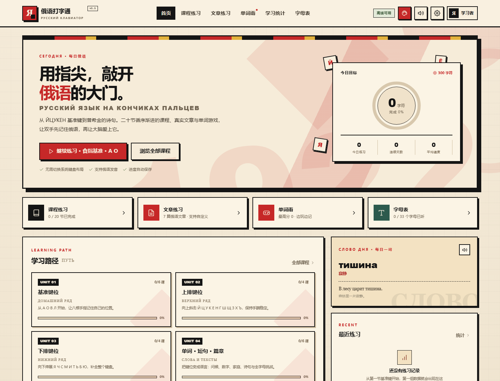
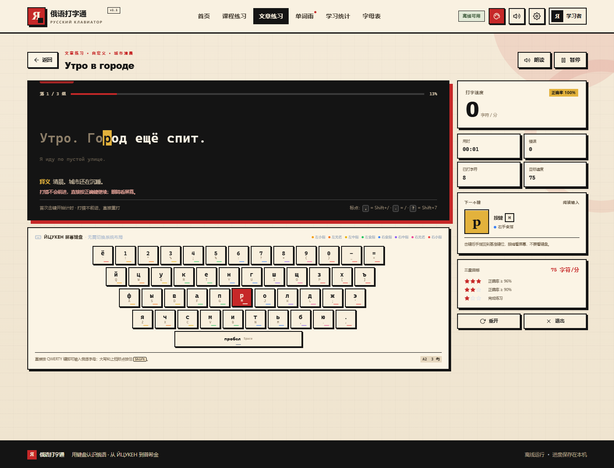
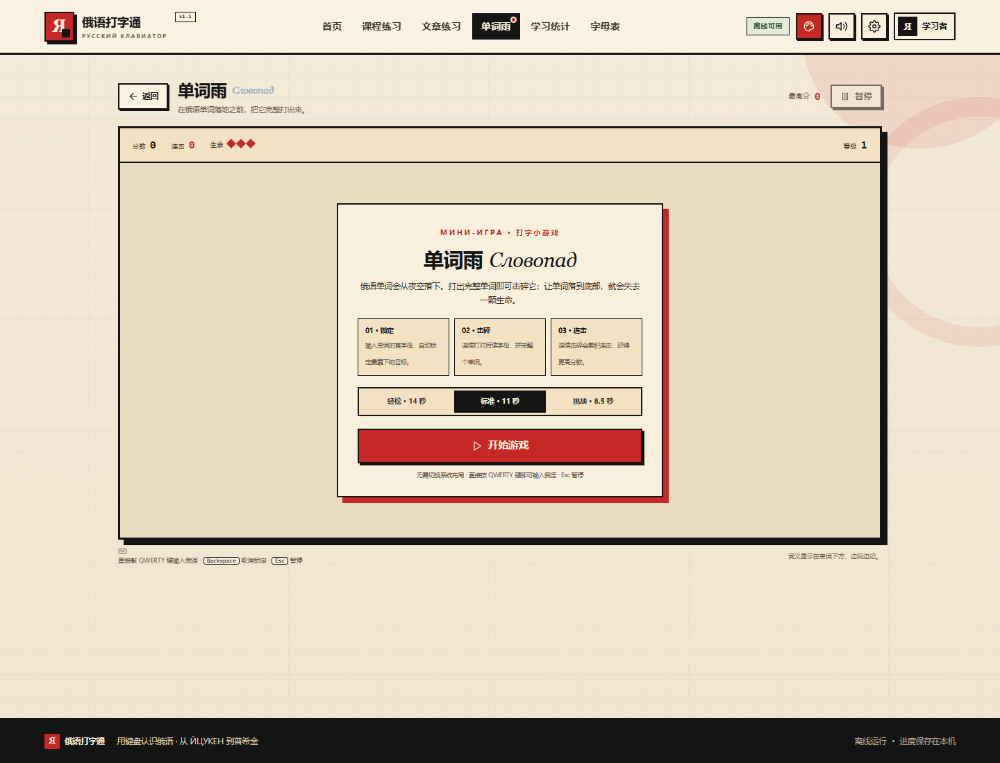
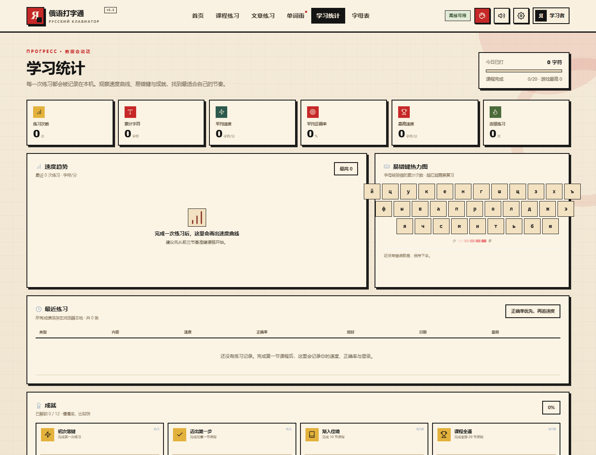
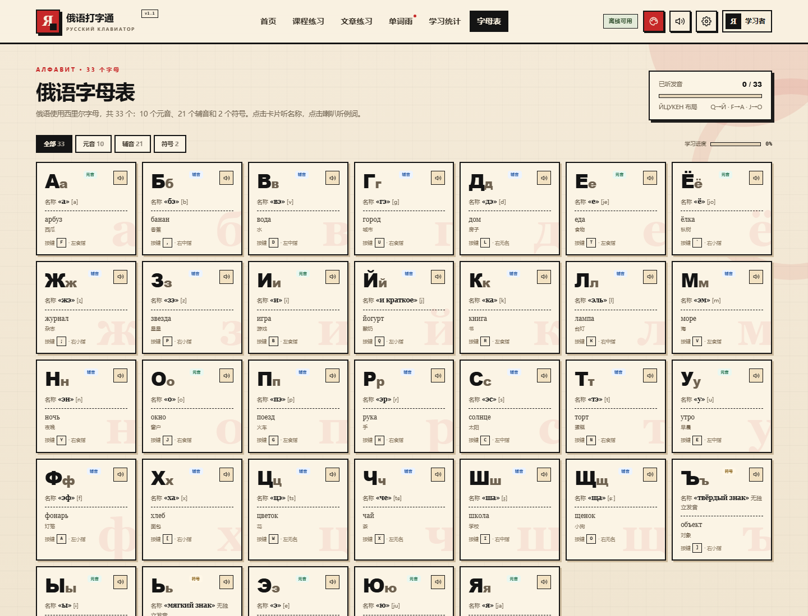
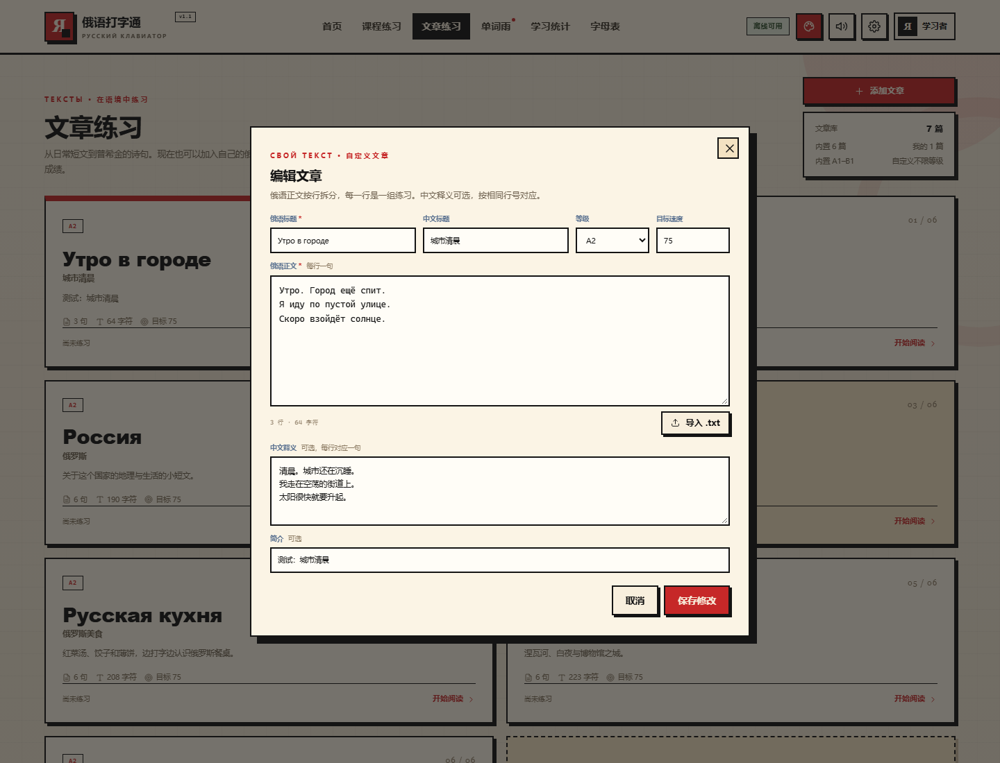
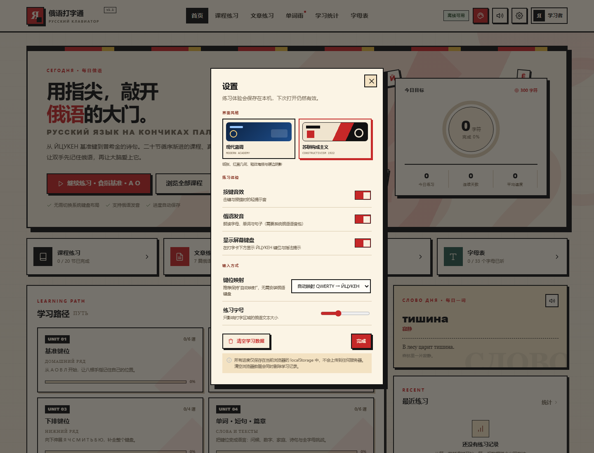

# 俄语打字通 1.1 · Русский Клавиатор

> 一个模仿《金山打字通》的离线俄语打字学习软件：从 ЙЦУКЕН 基准键开始，练到单词、文章、普希金诗句和打字小游戏。

**版本 1.1.0** · **平台** Web / Windows 10–11 x64 · **完全离线** · **无需切换系统俄语键盘**



---

## 目录

- [亮点](#亮点)
- [下载与运行](#下载与运行)
- [功能一览](#功能一览)
- [自定义文章](#自定义文章)
- [艺术风格](#艺术风格)
- [键位说明](#键位说明)
- [快捷键](#快捷键)
- [数据保存在哪里](#数据保存在哪里)
- [项目结构](#项目结构)
- [验证情况](#验证情况)
- [常见问题](#常见问题)
- [版本记录](#版本记录)

---

## 亮点

- **20 节循序渐进课程**：基准键 → 上下排 → 单词短句 → 普希金诗歌与全字母挑战
- **6 篇内置文章 + 自定义文章**：粘贴自己的俄语文本，按行生成练习
- **两套完整艺术风格**：现代蓝调 / 苏联先锋派构成主义
- **不用切换键盘布局**：QWERTY 直接映射到 ЙЦУКЕН
- **真正的指法训练**：屏幕键盘高亮下一个键，显示左右手、手指与 Shift
- **完整成绩系统**：速度、正确率、用时、星级、速度曲线、易错键热力图、成就
- **单词雨小游戏**：锁定、连击、等级、生命、最高分
- **33 个字母表**：名称、IPA、例词、按键、手指分工、系统俄语发音
- **本地优先**：不联网、不上传，进度保存在本机


---

## 下载与运行

| 版本 | 文件 | 说明 |
| --- | --- | --- |
| Windows 桌面版 | [俄语打字通 1.1.exe](<俄语打字通桌面版 1.1/俄语打字通 1.1.exe>) | 单文件，约 66.9 MB，无需安装 |
| 桌面版压缩包 | [俄语打字通-桌面版-1.1.zip](俄语打字通-桌面版-1.1.zip) | exe + 启动脚本 + 使用说明 + 预览图 |
| 网页版 | [index.html](russian-typing-tutor/index.html) | 双击用 Edge / Chrome 打开 |
| 网页版压缩包 | [俄语打字通-v1.1.zip](俄语打字通-v1.1.zip) | 完整网页源码、截图与说明 |
| 详细文档 | [russian-typing-tutor/README.md](russian-typing-tutor/README.md) | 更完整的功能与键位说明 |

### Windows 桌面版

1. 解压 `俄语打字通-桌面版-1.1.zip`。
2. 双击 `俄语打字通 1.1.exe`。
3. 首次运行会在同目录生成 `data` 文件夹，保存进度、自定义文章、主题和 WebView2 缓存。

系统要求：**Windows 10 / 11 64 位** + **Microsoft Edge WebView2 运行时**（Windows 11 和大多数 Windows 10 已内置）。

> 桌面版未做商业代码签名。如果 Windows 提示“未知发布者”，请选择“更多信息 → 仍要运行”。如果双击 exe 没有反应，请先右键 exe → 属性 → 勾选“解除锁定”，或双击同目录的 `启动俄语打字通.bat`。

### 网页版

直接双击 `russian-typing-tutor/index.html`，推荐 Edge / Chrome。无需安装、无需启动本地服务器。

---

## 功能一览

### 1. 课程练习

| 单元 | 内容 | 课程 |
| --- | --- | --- |
| 01 基准键位 | А О · В Л · Ы Д · Ф Ж · П Р Э | 第 1–6 课 |
| 02 上排键位 | Й Ц У К · Н Г Ш Щ · З Х Ъ | 第 7–10 课 |
| 03 下排键位 | Я Ч С М · И Т Ь Б · Ю 与标点 | 第 11–14 课 |
| 04 单词与篇章 | 问候、数字、家庭、短句、诗歌、全字母句 | 第 15–20 课 |

- 打错不前进，必须按对当前字符
- 实时显示速度、正确率、用时、错误数和进度
- 每节课记录最佳速度、最佳正确率与三星评价



### 2. 文章练习

内置文章：

- 《Моё утро》我的早晨（A1）
- 《Россия》俄罗斯（A2）
- 《Зимнее утро》冬日清晨 · 普希金（B1）
- 《Русская кухня》俄罗斯美食（A2）
- 《Санкт-Петербург》圣彼得堡（A2）
- 《Письмо другу》给朋友的信（A2）

每行都配中文释义；句首大写、空格、逗号、句号、问号、感叹号都参与统计。

### 3. 单词雨

俄语单词从天而降。输入首字母锁定目标，拼完整个单词即可击碎；连续击碎累积连击，单词落到底部会失去生命。包含三档难度、等级、最高分和词义提示。



### 4. 学习统计

- 练习次数、累计字符、平均速度、平均正确率、最高速度、连续天数
- 最近 12 次练习的速度曲线
- ЙЦУКЕН 易错键热力图
- 最近练习记录
- 12 个成就



### 5. 字母表与发音

33 个西里尔字母，包含名称、IPA、例词、中文释义、对应按键与手指分工。点击卡片或喇叭调用系统俄语语音。



---

## 自定义文章

**位置**：文章练习 → 添加文章

**步骤**：

1. 填写俄语标题（必填）、中文标题、等级和目标速度。
2. 在“俄语正文”中粘贴文本，**每行一句**。
3. 可选填写中文释义，行号与俄语正文一一对应。
4. 可选点击“导入 .txt”读取 UTF-8 纯文本。
5. 保存后，文章会显示在文章库最前面，并带有“我的文章”标记。

**规则与细节**：

- 俄语正文只接受俄语字母、数字、空格和当前键位可输入的标点。
- 如果混入中文等无法输入的字符，会提示具体行号和字符。
- 常见的 `—`、`–`、`«»`、`“”`、`…`、弯引号会自动规范化成可输入符号。
- 自定义文章可以编辑、删除、反复练习。
- 删除文章后，历史成绩仍会保留在统计记录中。
- 自定义文章和设置都保存在本机，刷新或重启后仍然存在。



---

## 艺术风格

在顶栏点击调色板图标快速切换，或进入「设置 → 界面风格」预览选择。选择会随进度保存。

### 现代蓝调（默认）

深蓝渐变、柔和卡片、学院感排版，适合日常练习。

### 苏联先锋派 · 构成主义

纸张底色、红黑几何、粗体海报标题、硬边偏移阴影。覆盖首页、课程、文章、练习、单词雨、统计、字母表和全部弹窗。




---

## 键位说明

默认把 QWERTY 键盘自动映射为俄语 ЙЦУКЕН 布局：

| 按键 | 俄语 | 按键 | 俄语 | 按键 | 俄语 |
| --- | --- | --- | --- | --- | --- |
| Q | Й | A | Ф | Z | Я |
| W | Ц | S | Ы | X | Ч |
| E | У | D | В | C | С |
| R | К | F | А | V | М |
| T | Е | G | П | B | И |
| Y | Н | H | Р | N | Т |
| U | Г | J | О | M | Ь |
| I | Ш | K | Л | , | Б |
| O | Щ | L | Д | . | Ю |
| P | З | ; | Ж | / | . |
| [ | Х | ' | Э | \` | Ё |
| ] | Ъ | | | | |

- 大写字母：按住 `Shift`
- 逗号：`Shift + /`
- 句号：`/`
- 问号：`Shift + 7`
- 感叹号：`Shift + 1`
- 冒号：`Shift + 6`
- 分号：`Shift + 4`

如果系统已经切换到俄语布局，也可以在「设置 → 键位映射」中选择“直接输入”。

---

## 快捷键

| 场景 | 按键 | 功能 |
| --- | --- | --- |
| 练习中 | `Esc` | 暂停 / 打开暂停面板 |
| 练习中 | `Shift` | 输入大写字母或上档标点 |
| 单词雨 | 俄语单词首字母 | 锁定最靠下的目标 |
| 单词雨 | `Backspace` | 取消当前锁定 |
| 单词雨 | `Esc` | 暂停 / 继续 |
| 游戏结束后 | `Enter` | 再来一局 |

---

## 数据保存在哪里

### 网页版

- 浏览器 `localStorage`，键名：`ru-typing-tutor-v1`
- 使用同一浏览器、同一路径打开才能持续保存

### Windows 桌面版

- exe 同目录的 `data` 文件夹
- `data/WebView2` 保存 localStorage 与页面缓存
- `data/web` 是每次启动解压出的网页资源
- 移动软件时建议把整个文件夹一起移动

在「设置 → 清空学习数据」中可重置课程、成绩、成就、自定义文章、主题和游戏最高分。

---

## 项目结构

```text
D:\ai work
├─ README.md                         # 本文件：项目总览
├─ russian-typing-tutor/             # 网页版源码
│  ├─ index.html
│  ├─ css/style.css
│  ├─ js/
│  │  ├─ data.js                     # 字母、课程、内置文章、词库、成就
│  │  ├─ core.js                     # 存储、键位映射、音效、弹窗、键盘
│  │  ├─ practice.js                 # 打字练习与成绩结算
│  │  ├─ game.js                     # 单词雨
│  │  └─ app.js                      # 路由、页面渲染、自定义文章、主题
│  ├─ screenshots/
│  └─ README.md                      # 更完整的功能文档
├─ desktop-source/                   # Windows 桌面封装源码（.NET 8 + WebView2）
├─ 俄语打字通桌面版 1.1/
│  ├─ 俄语打字通 1.1.exe
│  ├─ 启动俄语打字通.bat
│  ├─ 使用说明.txt
│  └─ 预览.png
├─ 俄语打字通-v1.1.zip               # 网页版压缩包
└─ 俄语打字通-桌面版-1.1.zip          # 桌面版压缩包
```

---

## 验证情况

- 33 个字母、20 节课程、6 篇内置文章全部通过数据校验
- 无头 Edge 完成课程与文章全文输入，验证大写、空格、标点、错误反馈和成绩结算
- 自定义文章：空标题/含中文校验、破折号规范化、保存、置顶、编辑、删除、刷新持久化均正常
- 自定义文章完整练习 64 字符：64 正确 / 0 错误，3 星，成绩正常写入
- 主题：现代蓝调与苏联构成主义全页面切换、设置预览、刷新恢复均正常
- 桌面版 1.1.0：实际启动、8 字符输入、暂停恢复正常
- 桌面 exe 内实际添加自定义文章并切换构成主义风格成功
- 启动脚本 `启动俄语打字通.bat` 实际启动验证通过
- 390 × 844 移动端无横向溢出；浏览器控制台无错误

---

## 常见问题

### 双击 exe 没反应？

1. 确认已经完整解压，而不是直接在压缩包里双击。
2. 右键 exe → 属性 → 勾选“解除锁定”。
3. 双击同目录的 `启动俄语打字通.bat`。
4. 如果 Windows 安全中心已拦截，在“病毒和威胁防护 → 保护历史记录”中选择允许。

### 提示“未知发布者”？

桌面版没有购买商业代码签名证书。点击“更多信息 → 仍要运行”即可。

### 俄语朗读没有声音？

需要系统安装俄语语音包：Windows 设置 → 时间和语言 → 语言和区域 → 添加俄语 → 语音。

### 数据会丢吗？

网页版清浏览器数据会丢失；桌面版删除 `data` 文件夹会丢失。移动桌面版时请连同 `data` 一起移动。

### 支持手机吗？

页面可以在手机浏览器打开，但打字练习和单词雨需要实体键盘。

---

## 版本记录

### 1.1.0

- 新增自定义文章：添加、编辑、删除、逐行释义、.txt 导入、置顶显示
- 新增苏联先锋派 · 构成主义艺术风格
- 新增现代蓝调 / 构成主义主题切换与持久化
- 更新 Windows 桌面版到 1.1.0
- 新增自定义文章校验与排版符号规范化
- 完善构成主义风格下的游戏、统计、字母表和弹窗

### 1.0.0

- 20 节俄语打字课程
- 6 篇内置文章
- 单词雨小游戏
- 学习统计、易错键热力图、成就
- 33 字母表与系统发音
- 本地进度保存
- Windows 单文件 exe

---

## 说明

- 灵感来自《金山打字通》的课程与练习结构。
- 俄语课程、例词与文章为学习示例；普希金诗歌为公版作品。
- 桌面封装使用 .NET 8 + Microsoft Edge WebView2。
- 当前项目未附带正式开源许可证；如需公开分发，请先补充 LICENSE 文件。
