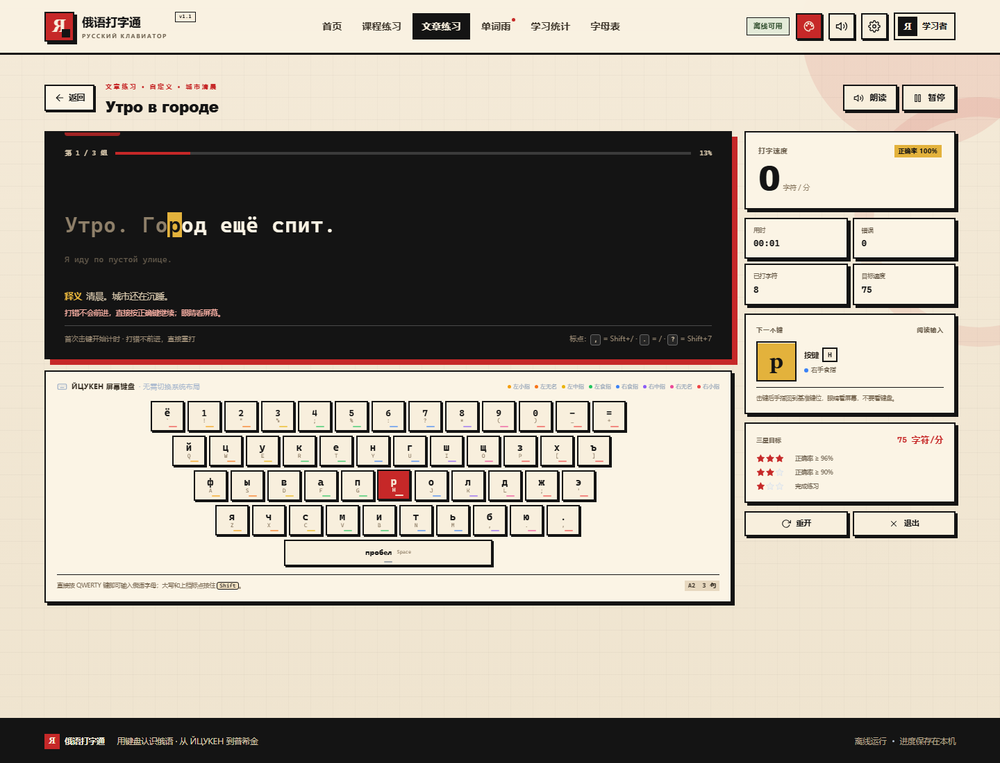
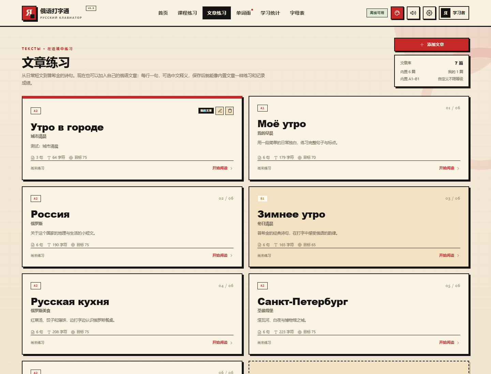
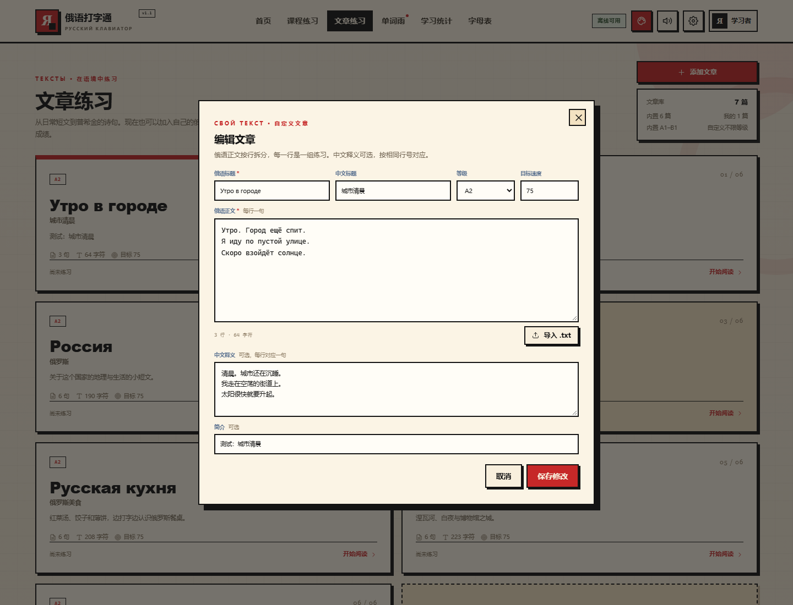
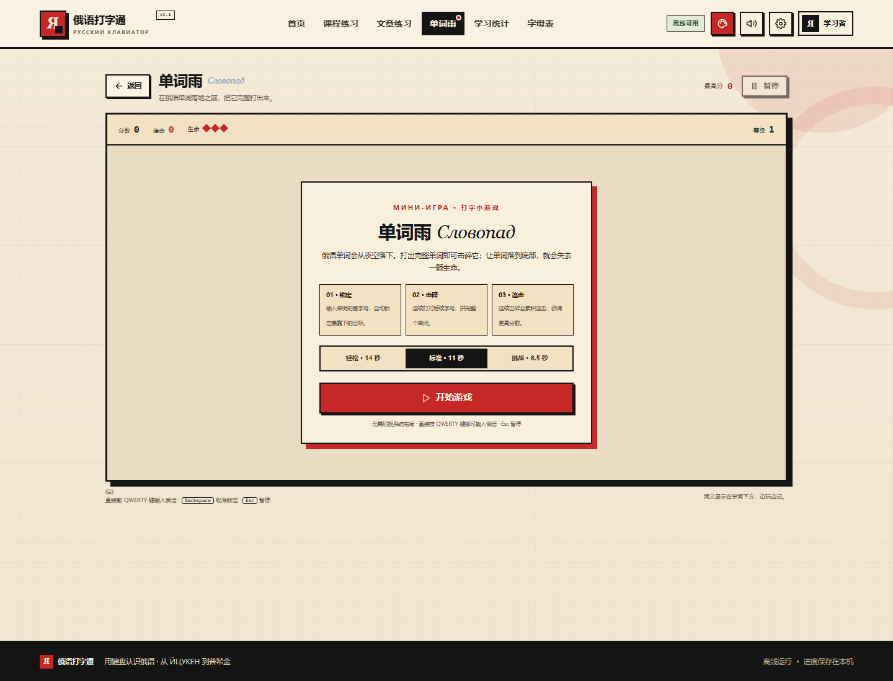
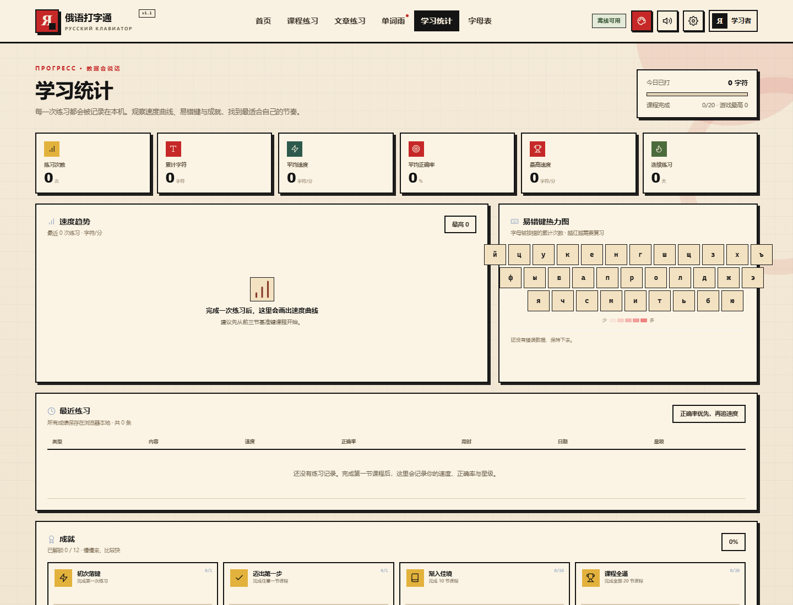
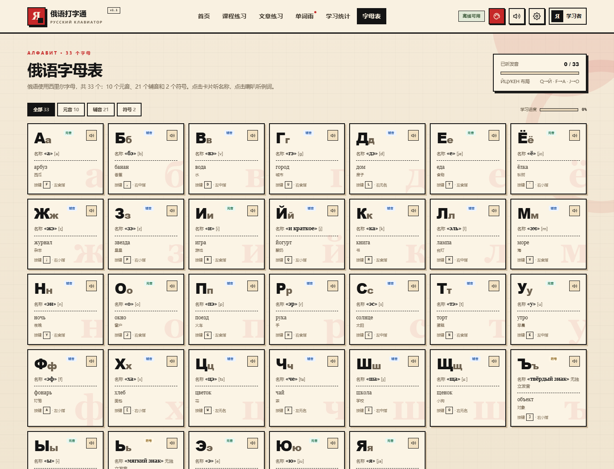
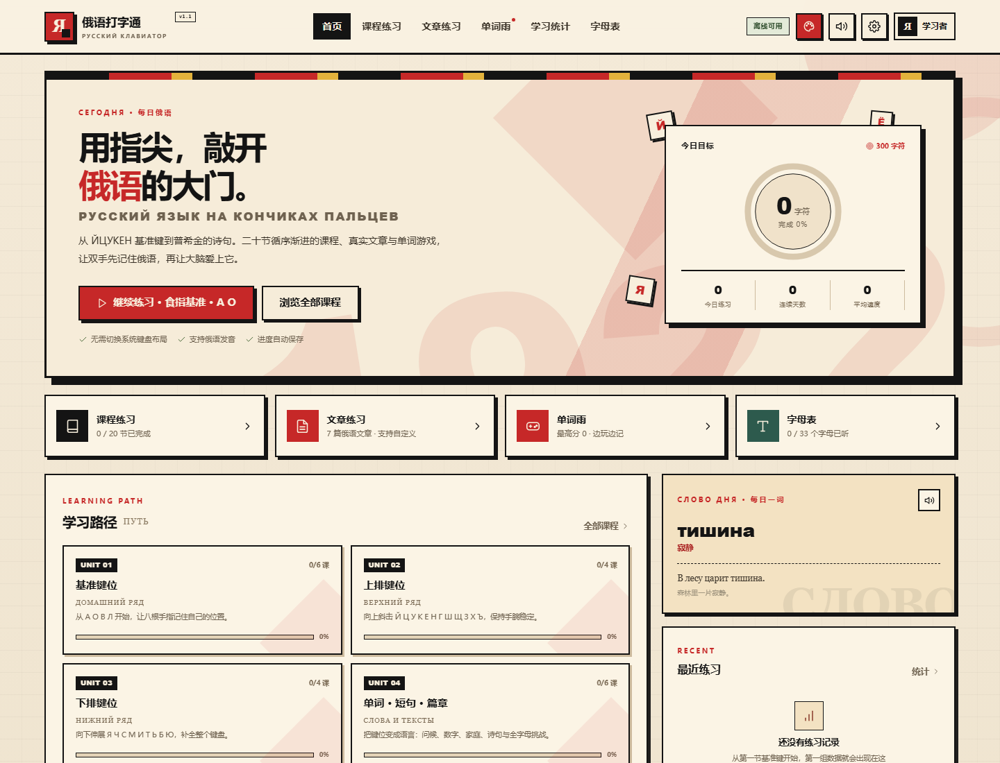
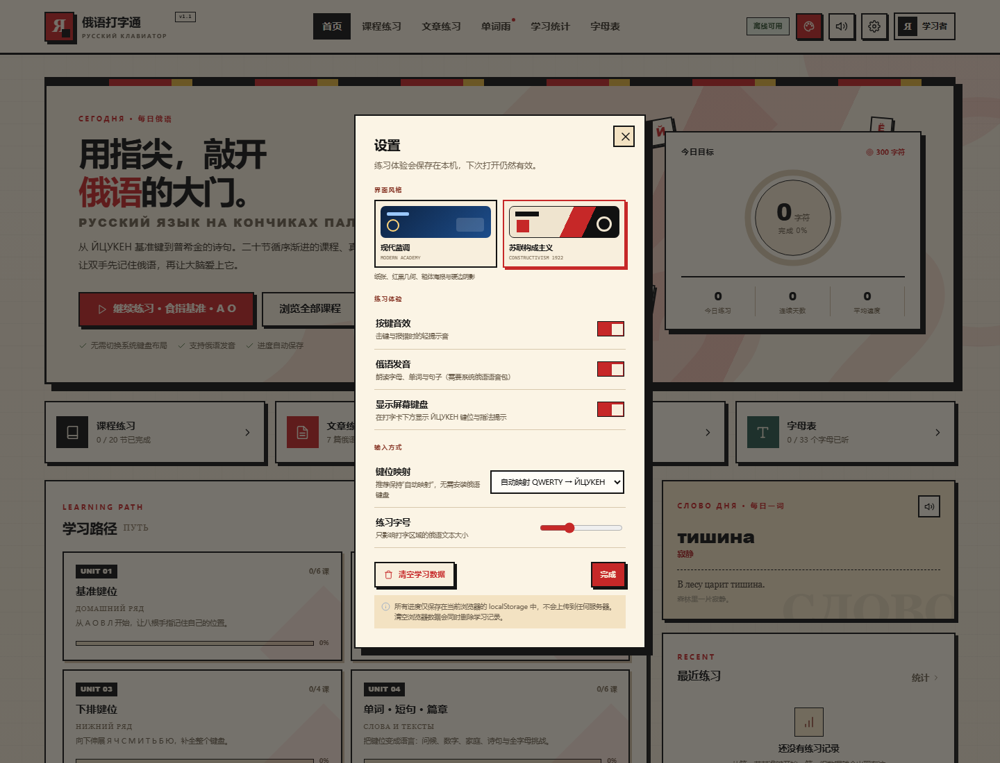

# 俄语打字通 1.1 · Русский Клавиатор

一个模仿《金山打字通》的**离线俄语打字学习软件**。从 ЙЦУКЕН 基准键开始，经过单词、短句、文章与打字小游戏，把俄语输入变成肌肉记忆。

无需安装、无需联网，也不需要把系统键盘切换成俄语——直接按 QWERTY 键，软件会自动映射成俄语字母。

1.1 新增：**自定义文章**，以及可切换的**现代蓝调 / 苏联先锋派构成主义**艺术风格。


## 快速开始

**方式一**：双击 `index.html`，用 Edge / Chrome 打开。

**方式二**：双击 `启动俄语打字通.bat`。

推荐使用桌面浏览器和实体键盘；移动端也能打开，但打字练习需要外接键盘。

### Windows 桌面版（.exe）

也可以直接运行 `俄语打字通 1.1.exe`（Windows 10 / 11 64 位），无需安装浏览器或配置本地服务器。桌面版基于 .NET 8 + Microsoft Edge WebView2，首次运行会在 exe 同目录生成 `data` 文件夹，用于保存课程进度、成绩、自定义文章、设置和 WebView2 缓存。

桌面版未做商业代码签名；如果 Windows 显示“未知发布者”，请选择“更多信息 → 仍要运行”。如果双击 exe 无反应，可先右键 exe → 属性 → 勾选“解除锁定”，或双击同目录的 `启动俄语打字通.bat`。

---

## v1.1 更新

- **自定义文章**：在「文章练习」中点击“添加文章”，粘贴俄语正文（每行一句），可选填写逐行中文释义，保存后即可练习。
  - 支持从 UTF-8 `.txt` 导入
  - 自定义文章会出现在文章库最前面，可随时编辑、删除
  - 自动规范化常见的破折号、弯引号和省略号，再校验键位可输入性
- **艺术风格**：新增“苏联先锋派 · 构成主义”主题。
  - 纸张底色、红黑几何、粗体海报标题、硬边偏移阴影
  - 与原有“现代蓝调”风格完整并存
  - 点击顶栏调色板图标可快速切换，也可在设置中预览选择
  - 风格设置随学习进度一起保存在本机

---

## 功能一览

### 1. 循序渐进课程（20 节）

从基准行到全字母挑战，每节课都有指法提示、目标速度和三星评价：

| 单元 | 内容 | 课程 |
| --- | --- | --- |
| 01 基准键位 | А О · В Л · Ы Д · Ф Ж · П Р Э | 第 1–6 课 |
| 02 上排键位 | Й Ц У К · Н Г Ш Щ · З Х Ъ | 第 7–10 课 |
| 03 下排键位 | Я Ч С М · И Т Ь Б · Ю 与标点 | 第 11–14 课 |
| 04 单词与篇章 | 问候、数字、家庭、短句、普希金诗歌、全字母句 | 第 15–20 课 |

- 实时显示速度、正确率、用时、错误数与进度
- 打错不会前进，必须按对当前字符；错误会汇总到易错键热力图
- 屏幕键盘高亮“下一个键”，并显示左右手、手指、是否需要 Shift
- 每节课记录最佳速度与星级，全部保存在本机



### 2. 文章练习（6 篇内置 + 自定义）

内置：

- 《Моё утро》我的早晨（A1）
- 《Россия》俄罗斯（A2）
- 《Зимнее утро》冬日清晨 · 普希金（B1）
- 《Русская кухня》俄罗斯美食（A2）
- 《Санкт-Петербург》圣彼得堡（A2）
- 《Письмо другу》给朋友的信（A2）

自定义文章：

- 点击“添加文章”，按行粘贴任意俄语文本；每行会成为一组练习
- 可选填写逐行中文释义；支持导入 UTF-8 `.txt`
- 保存后显示在文章库最前面，带“我的文章”标记
- 可编辑、删除；练习成绩与内置文章使用同一套记录
- 自动处理常见的 `—`、`«»`、`“”`、`…` 等排版符号，再检查是否能被 ЙЦУКЕН 键位输入

每行都配中文释义（如有）；句首大写、空格、逗号、句号、问号、感叹号都算练习的一部分。





### 3. 单词雨小游戏

俄语单词从天而降，打出首字母锁定目标，拼完整个单词即可击碎。连续击碎可累积连击，单词落到底部会失去生命。包含三档难度、等级、最高分与词义提示。



### 4. 学习统计

- 练习次数、累计字符、平均速度、平均正确率、最高速度、连续天数
- 最近 12 次练习的速度曲线
- ЙЦУКЕН 易错键热力图 + 最常出错的键
- 最近练习记录表
- 12 个成就（初次落键、课程全通、速度 100、字母启蒙等）



### 5. 字母表与发音

33 个西里尔字母，标注名称、IPA、例词、中文释义、对应按键与手指。点击卡片或喇叭即可调用系统俄语语音朗读（需要系统安装俄语语音包）。



### 6. 界面艺术风格

两套完整视觉系统，覆盖首页、课程、文章、练习、游戏、统计、字母表和弹窗：

- **现代蓝调**：深蓝渐变、柔和卡片、学院感排版（默认）
- **苏联先锋派 · 构成主义**：纸张底色、红黑几何、粗体海报标题、硬边偏移阴影

点击顶栏调色板按钮可在两种风格间快速切换，或进入「设置 → 界面风格」预览后选择。选择会保存到本机。





### 7. 其他

- 按键音效 / 报错音 / 完成音，可关闭
- 练习暂停（计时同步停止）、重新开始、离开确认
- 可隐藏屏幕键盘、调整练习字号
- 自动保存课程进度、自定义文章、成绩与界面风格

---

## 键位说明：不用切换系统布局

软件默认把你的 QWERTY 键盘自动映射为俄语 ЙЦУКЕН 布局。例如：

| 按键 | 俄语 | 按键 | 俄语 | 按键 | 俄语 |
| --- | --- | --- | --- | --- | --- |
| Q | Й | A | Ф | Z | Я |
| W | Ц | S | Ы | X | Ч |
| E | У | D | В | C | С |
| R | К | F | А | V | М |
| T | Е | G | П | B | И |
| Y | Н | H | Р | N | Т |
| U | Г | J | О | M | Ь |
| I | Ш | K | Л | , | Б |
| O | Щ | L | Д | . | Ю |
| P | З | ; | Ж | / | . |
| [ | Х | ' | Э | \` | Ё |
| ] | Ъ | | | | |

- 大写字母：按住 `Shift` 再按对应键
- 逗号：`Shift + /`
- 句号：`/`
- 问号：`Shift + 7`
- 感叹号：`Shift + 1`
- 冒号：`Shift + 6`
- 分号：`Shift + 4`

如果系统已经切换到俄语布局，也可以在「设置 → 键位映射」中选择「直接输入」。默认的「自动映射」在两种情况下都能正常工作。

---

## 练习快捷键

| 场景 | 按键 | 功能 |
| --- | --- | --- |
| 练习中 | `Esc` | 暂停 / 打开暂停面板 |
| 练习中 | `Shift` | 输入大写字母或上档标点 |
| 单词雨 | 俄语单词首字母 | 锁定最靠下的目标 |
| 单词雨 | `Backspace` | 取消当前锁定 |
| 单词雨 | `Esc` | 暂停 / 继续 |
| 游戏结束后 | `Enter` | 再来一局 |

---

## 数据存储

- 使用浏览器 `localStorage`，键名为 `ru-typing-tutor-v1`
- 不发送任何网络请求，所有成绩、自定义文章和界面风格只在本机
- 在「设置 → 清空学习数据」中可重置全部课程、成绩、成就、自定义文章与游戏最高分
- 清除浏览器缓存/站点数据也会清除学习记录

> 如果使用 `file://` 直接打开，部分浏览器会把每个本地文件视为独立来源；用同一浏览器、同一路径打开即可持续保存。Edge / Chrome 实测正常。

---

## 项目结构

```text
russian-typing-tutor/
├─ index.html                 # 单页应用外壳
├─ 启动俄语打字通.bat          # 双击启动
├─ css/
│  └─ style.css              # 全部界面样式（响应式）
├─ js/
│  ├─ data.js                # 字母、课程、文章、词库、成就
│  ├─ core.js                # 存储、键位映射、音效、弹窗、键盘渲染
│  ├─ practice.js            # 打字练习引擎与成绩结算
│  ├─ game.js                # 单词雨游戏
│  └─ app.js                 # 路由、各页面渲染、设置
├─ screenshots/              # 界面预览
└─ README.md
```

无构建步骤、无第三方运行时依赖。使用原生 HTML / CSS / JavaScript，打开即可运行。

---

## 已验证

- 33 个字母全部具备名称、发音、例词与键位映射
- 20 节课程共 1666 个可输入字符、6 篇内置文章共 1151 个字符，全部通过键位可输入性校验
- 无头 Edge 完整输入课程与文章（包含大写、空格、句号、问号），成绩与星级正常结算并写入 localStorage
- 错误输入不前进、错误计数与易错键汇总正常
- 暂停、设置弹窗、离开确认会冻结计时，继续后恢复正常
- 单词雨锁定、拼完击碎、失误扣命、暂停 / 继续、最高分记录正常
- 字母表点击标记与进度保存正常
- **v1.1 自定义文章**：空标题/中文正文校验正常；普通俄语文本、逐行中文释义、破折号规范化、保存、置顶显示、编辑、删除、完整练习与成绩记录均正常；刷新页面后仍保留
- **v1.1 艺术风格**：现代蓝调与苏联构成主义全页面切换、顶栏按钮、设置预览、设置持久化正常
- 390 × 844 移动端无横向溢出；屏幕键盘可横向滚动并自动跟随当前键

---

## 已知限制

- 俄语朗读依赖系统语音包；如果 Windows 没有安装俄语 TTS 语音，朗读可能无声或使用默认语音。可在「设置 → 时间和语言 → 语言」中添加俄语语音。
- 桌面版需要 Microsoft Edge WebView2 运行时；Windows 11 和大多数 Windows 10 已内置，缺少时请安装 Evergreen Runtime。
- 桌面版为单文件便携程序，学习数据保存在 exe 同目录的 `data` 文件夹；移动软件时建议连同 `data` 一起移动。
- 桌面版未签名，首次运行可能触发 SmartScreen“未知发布者”提示。
- 自定义文章只接受俄语字母、数字、空格和当前键位可输入标点；中文正文会提示具体行号与字符。常见的破折号、弯引号和省略号会自动规范化。
- 游戏与打字练习都需要实体键盘。
